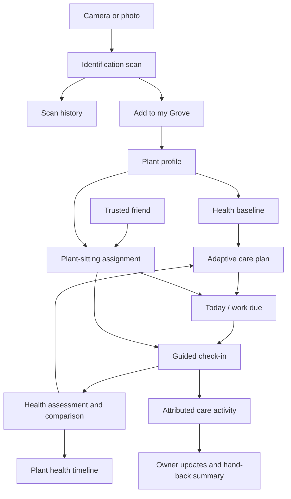

# Grove Product Source of Truth

> Status: foundational product definition  
> Last updated: 27 July 2026  
> Purpose: this is the canonical product context for Grove. Product, design, engineering, AI prompts, analytics, and future planning should use the language and rules in this file. When a product decision changes, update this file before allowing different parts of the app to drift.
>
> Implementation companion: [`APP_PLAN.md`](APP_PLAN.md) translates this product definition into screens, architecture, services, delivery phases, and release gates.
> Design companion: [`DESIGN.md`](DESIGN.md) is the canonical visual-design contract — tokens, type, motion, and the rules that keep every screen looking like one product.

## Product in one sentence

Grove is a plant buddy that identifies plants, helps people understand and improve the health of plants they own through recurring photo check-ins, and lets trusted friends care for those plants when the owner is away.

## The problem

People encounter plants they cannot identify, buy or inherit plants without understanding their needs, and notice symptoms only after a plant has deteriorated. Generic watering reminders are often too blunt: a calendar cannot see the soil, leaves, location, season, or the effect of recent care. When owners travel, plant-care instructions are fragmented across messages and there is no reliable history of what a sitter actually did.

Grove should answer four practical questions:

1. **What is this plant?**
2. **How healthy is my plant right now?**
3. **What should I do next, and is it working?**
4. **Who can safely look after it when I cannot?**

## Product promise

Grove helps users build a healthy real-world garden, not merely a digital collection. Each owned plant gets a living record containing its identity, environment, health observations, care plan, actions, progress photos, and trusted carers. Over time, Grove should become more useful because it understands the history and normal appearance of that specific plant.

## Product principles

1. **Check, then act.** Notifications should prompt users to inspect a plant, not blindly tell them to water it.
2. **Every recommendation explains why.** Advice should cite the observed signal, environmental context, or known species need behind it.
3. **Progress matters more than a single score.** Direction of travel and visible changes are more useful than false precision.
4. **Care is collaborative but accountable.** Owners can delegate care while every action remains attributed to the person who performed it.
5. **The plant is the social object.** Social activity should be connected to real plants, progress, questions, or care—not an unrelated engagement feed.
6. **Uncertainty must be visible.** Identification, health assessment, and diagnosis need confidence levels and safe escalation when evidence is weak.
7. **Low effort earns retention.** A routine check-in should take under a minute per healthy plant.

## Plant page information hierarchy

The plant page leads with the latest condition estimate, its evidence date and a
plain-language assessment. It then gives one next useful action. A fresh, healthy
assessment with no due care should say that no action is needed today, without
immediately asking for another photo.

Use prominent numbers where the records support them: condition out of 100, days
since logged watering, the next check-in date, and change across dated photo
assessments. Keep photo estimates, owner observations and measured readings
labelled by source. Never infer moisture percentages or leaf counts from data that
does not contain them. Missing evidence has a useful next check, not a low score.

Returning owners should see dated comparison photos, the assessment trend and
recent care together. A first scan explains the baseline until there is enough
history to compare. Leaves, soil and light are the three primary care signals;
growth, posture and care history are available on expansion. Detailed care and
household safety remain accessible on the page.

## Core product loops

### 1. Discover: identify any plant

A user photographs an unknown plant. Grove returns likely species matches, confidence, distinguishing traits, essential care information, toxicity warnings, and an option to save the result.

An identification does not automatically become an owned plant. The result can be:

- a one-off identification saved to scan history;
- added to a wishlist or collection later;
- adopted into the user's Grove as a plant they own and care for.

### 2. Adopt: add an owned plant to a Grove

The user photographs a plant they own. Grove identifies it, performs an initial health assessment, and asks for the contextual details a photograph cannot reliably provide:

- nickname;
- room or outdoor location;
- approximate light;
- pot and drainage details;
- optional acquisition date and source;
- recent watering or care;
- pets or children in the home when toxicity is relevant.

The result is a persistent **Plant Profile**, an initial **Health Baseline**, and a suggested **Care Plan**. The user confirms or corrects the identification before relying on species-specific advice.

### 3. Improve: recurring health check-ins

The default cadence is every 14 days, adjusted when a plant is recovering or stable. A check-in asks for a guided photo and a few quick observations. Grove compares the new evidence with the plant's baseline and recent history, then reports:

- whether health appears better, stable, or worse;
- the observed changes;
- what recent care appears to be helping;
- the next one to three recommended actions;
- warning signs that require an earlier follow-up;
- the next check-in date.

A struggling plant may use shorter recovery check-ins. A stable plant may use a lighter fortnightly or monthly cadence. Watering and other care events can be logged between full check-ins.

### 4. Delegate: plant sitting

An owner selects a trusted friend, plants, date range, and permissions. The sitter gets a focused care view showing only what is due, how to inspect each plant, and any owner notes. The sitter can log care and complete check-ins on the owner's behalf. The plant history records both the owner and the actual actor.

At the end of the sitting period, the owner receives a concise hand-back summary: plants checked, care performed, skipped or overdue work, new issues, photos, and questions.

## How the product connects

## Feature map

### Identification

- Live camera and photo-library input
- Image quality guidance before submission
- Ranked species candidates and confidence
- Confirmation or correction by the user
- Species overview and care summary
- Toxicity and handling warnings
- Scan history
- “Add to my Grove” transition
- Clear distinction between plant identification and condition diagnosis

### My Grove

- Visual collection of owned plants
- Health and attention status visible at a glance
- Rooms, outdoor areas, and custom groups
- Search and filters: needs attention, check-in due, recovering, sitting assignment
- Plant profile with current photo, identity, location, care plan, timeline, carers, and notes
- Plant states: onboarding, healthy, monitor, recovering, urgent attention, dormant, archived, deceased

### Health assessment

- Initial baseline when a plant is adopted
- Guided photos that encourage comparable angle, distance, and lighting
- Visible observations such as discoloration, drooping, damage, pests, sparse growth, and new growth
- User observations that vision alone cannot confirm: soil moisture, smell, recent watering, drainage, temperature changes, and pest evidence
- Overall health band plus a numerical score where helpful
- Confidence and evidence behind the assessment
- Candidate conditions rather than unsupported certainty
- Severity, suggested actions, and safe escalation
- Comparison against the same plant's previous check-ins

### Check-ins

- Default 14-day cadence
- One-tap “still looks good” path for stable plants, with a current photo
- Recovery cadence suggested according to the issue and action plan
- Better / stable / worse summary
- Care-plan completion and outcome tracking
- Notes and photos
- Owner or sitter attribution
- Snooze, skip reason, and reschedule
- Progress timeline and before/after views

### Care plans and logging

- Small, prioritised list of next actions
- Actions such as inspect soil, water, fertilise, prune, rotate, clean leaves, treat pests, repot, relocate, and monitor
- Explanation, urgency, and expected response window
- Care events can be logged outside a check-in
- Reminders are inspection-oriented and adapt to season, location, plant state, and recent actions
- Conflicting actions should be prevented; for example, repeated watering after a recent watering event

### Friends and social layer

- Friend requests and trusted connections
- Private-by-default Grove visibility
- Share an individual plant, progress update, or help request
- Plant-specific reactions and comments
- Advice remains distinguishable from Grove-generated guidance
- Optional public profile or Grove later; not required for the core care experience
- No generic social posting in the MVP

### Plant sitting

- Invite an existing friend or securely invite a new user
- Select all plants or a subset
- Start and end dates with automatic expiry
- Permissions scoped to view, log care, check in, and flag an issue
- Owner instructions, access notes, and emergency contact preferences
- Sitter dashboard containing due care only
- Every event records `performedBy`, `onBehalfOf`, and timestamp
- Owner receives real-time updates or a digest according to preference
- Sitter can escalate a concern with a photo and question
- Owner can revoke access immediately
- End-of-assignment hand-back summary

### Ask

Ari, Grove's botanist, answers plant questions with the asking user's own records attached. Ask is the fourth practical question — "what should I do next, and is it working?" — asked in the user's own words rather than through a check-in.

- Every answer is grounded in real state: the plant's identity, health band and trend, latest assessment, recent check-ins (appearance, soil moisture, new growth, notes), care due, region, and units. A question about the whole grove is grounded in a summary of every plant.
- Grounding is visible. The conversation says which record is being used, so a well-informed answer never looks like a lucky guess and the user can see what was shared to get it.
- Suggested questions are generated from that same state — a concern quoted from the last assessment, a declining trend, soil that was still wet — so the first tap is always about the user's actual plant.
- The plant record is untrusted input to the model, never instruction. This is enforced in the server prompt.
- Ari withholds rather than guesses on anything with a safety cost: pesticides, fungicides, hard pruning, toxicity and edibility. Suspected poisoning is routed to a vet or poison-control service, never answered.
- Ask is not a diagnosis surface. Diagnosis is a scan with photographic evidence; Ari explains, plans and reassures.
- **Metered, and the meter is the first premium boundary.** Free accounts get three questions a day; Grove Premium is unlimited. Three covers the daily habit with room for a follow-up, so the streak below is never behind a paywall — the wall lands on a fourth question, which is a conversation rather than the habit.

### Notifications

- Check-in due
- Recovery follow-up due
- Sitter task due or overdue
- Sitter logged care or raised an issue
- Friend responded to a plant question
- Health trend worsened or urgent symptoms were reported
- Notifications should combine work into a manageable session rather than create one alert per plant

## Primary navigation

1. **Today** — check-ins, recovery follow-ups, and care needing attention
2. **Ask** — Ari and the day's question about a real plant
3. **Scan** — prominent camera action for identification, diagnosis, or adding a plant
4. **Friends** — friend care, questions, progress, and sitting updates
5. **My Grove** — owned plants and spaces, identity, friends, sharing, preferences, and account settings

The Scan action is visually central rather than a conventional destination tab.

The second slot held a **Learn** tab until July 2026: nine static Academy lessons with a quiz each. It was retired because nine lessons is about nine days of content, after which the tab's own hero degraded to re-answering a quiz the user had already passed — a tab-bar slot going to zero value inside the exact window (D14–D30) where retention is decided, with nothing personal to the user in it and nothing anyone would pay for. The curriculum was not deleted: the lessons live on the Journey map, which is where their nodes, badges and XP always came from.

## Key user journeys

### Identify without ownership

1. Open Scan.
2. Photograph the plant.
3. Receive likely identity, confidence, distinguishing features, and basic information.
4. Confirm, choose another match, or mark it unknown.
5. Save to history, share, or add it to the Grove.

### Add an owned plant

1. Start from Scan or “Add plant” in My Grove.
2. Capture one guided whole-plant photo.
3. Confirm identification.
4. Add nickname, location, and environmental context.
5. Answer a short condition questionnaire.
6. Receive the baseline health assessment and first care plan.
7. Confirm reminders and the first follow-up date.

### Complete a regular check-in

1. Open a due plant from Today.
2. Recreate the guided reference photo.
3. Answer only the observations relevant to that plant.
4. Review comparison: better, stable, or worse.
5. See which previous actions appear helpful and what to do next.
6. Accept or adjust the next check-in.

### Diagnose a concerning plant

1. Choose “Something looks wrong” from the plant profile or Scan.
2. Capture one whole-plant photo and add context.
3. Receive possible conditions ordered by confidence, with evidence and alternative explanations.
4. Follow a conservative action plan.
5. Schedule an appropriate recovery check-in.
6. Escalate to an expert or local professional when the evidence is ambiguous, the plant is valuable, or chemical treatment is involved.

### Arrange plant sitting

1. Select “Arrange plant sitting.”
2. Choose a trusted friend, plants, dates, and permissions.
3. Review the generated care brief and add home-access notes separately from plant data.
4. Sitter accepts the assignment.
5. During the assignment, sitter logs actions and check-ins from a simplified Today view.
6. Owner sees attributed updates and can message or revise instructions.
7. Access expires and the owner receives a hand-back summary.

## Health model

### User-facing representation

Use a health band as the primary signal:

- **Thriving** — strong appearance and positive trend
- **Healthy** — no meaningful concern detected
- **Keep an eye on it** — mild or uncertain symptoms
- **Needs attention** — actionable issue likely
- **Urgent** — severe decline or high-risk signs

A 0–100 score can support progress visualisation, but it must never imply laboratory precision. Always show the trend, confidence, and observed reasons next to it.

### Assessment inputs

- current guided photos;
- previous photos of the same plant;
- confirmed species and expected seasonal behaviour;
- user-reported symptoms and soil state;
- environment and location;
- care-event history;
- time since previous check-in;
- active recovery plan;
- model confidence and image quality.

### Assessment output

- health band and optional score;
- change since last comparable observation;
- confidence;
- positive signs;
- concerns and evidence;
- candidate causes;
- next actions, priority, and timing;
- red flags and escalation guidance;
- recommended follow-up date.

The score should not change dramatically from weak evidence alone. If photographs are not comparable or confidence is low, Grove should ask for another photo or report that it cannot reliably assess the change.

## Conceptual data model

### User

- identity and profile
- friendships and blocks
- privacy and notification preferences
- Groves owned or shared

### Grove

- owner
- name and cover
- visibility
- spaces or locations
- members and roles
- plants

The first version gives each user one default Grove, while the model should allow shared or multiple Groves later.

### Plant

- stable identifier
- owning Grove
- nickname
- confirmed species and identification confidence
- acquisition details
- location and environment
- current state and health summary
- cover photo
- check-in cadence
- active care plan
- privacy
- archived or deceased state

### Observation

- plant
- date and actor
- source: onboarding, scheduled check-in, concern scan, or sitter check-in
- photos and image-quality metadata
- questionnaire answers
- model findings and confidence
- health assessment
- comparison with previous observation

### CareAction

- plant and optional care plan
- action type and instructions
- due window and priority
- completion, snooze, or skip state
- performer and timestamp
- notes and evidence photo

### CarePlan

- plant
- triggering assessment
- goal
- ordered actions
- start and review dates
- state: proposed, active, completed, replaced, or abandoned
- outcome at follow-up

### PlantSittingAssignment

- owner and sitter
- Grove or selected plants
- start and end dates
- status
- permissions
- owner instructions
- activity and hand-back summary

### SocialActivity

- actor
- related plant, observation, care action, or assignment
- audience
- reactions, comments, and moderation state

## Roles and permissions

| Capability | Owner | Grove member | Plant sitter | Friend/viewer |
| --- | ---: | ---: | ---: | ---: |
| View full plant history | Yes | Configurable | Assigned plants during dates | Shared items only |
| Edit plant identity or location | Yes | Configurable | No | No |
| Log care | Yes | Configurable | Assigned plants during dates | No |
| Complete check-in | Yes | Configurable | If granted | No |
| Change long-term care plan | Yes | Configurable | Suggest only | No |
| Invite or revoke carers | Yes | If granted | No | No |
| View home-access instructions | Yes | If explicitly shared | During assignment only | No |

Sensitive home-access notes must be stored and permissioned separately from publicly shareable plant content.

## AI and safety rules

- Identification and diagnosis are probabilistic; always show uncertainty.
- Health assessment is not a substitute for a botanist, horticultural professional, veterinarian, poison service, or medical professional.
- Toxicity warnings must use curated reference data and clearly separate risks to humans and different animals.
- Do not recommend ingestion or foraging based solely on image identification.
- Chemical treatment guidance needs conservative language, label compliance, regional availability awareness, and child/pet precautions.
- The system should prefer reversible, low-risk interventions when the diagnosis is uncertain.
- User corrections should update that plant's record without silently retraining or changing global truth.
- Preserve the original model result and subsequent correction for auditability.

## MVP

The first useful release should validate that users create a Grove and return to complete health check-ins.

### Include

- account and private profile;
- camera/photo identification through a third-party model or API;
- add an identified plant to My Grove;
- plant profiles and locations;
- initial photo-based health assessment with explicit confidence;
- guided fortnightly check-ins and progress timeline;
- care suggestions and manual care logging;
- Today queue and notifications;
- friends;
- time-limited plant-sitting assignments;
- sitter care logging and owner hand-back summary.

### Defer

- a broad public content feed;
- marketplace or plant trading;
- expert consultation network;
- proprietary identification-model training;
- hardware sensor integrations;
- hard virtual currencies and vanity mechanics (see "Journey and purposeful progression" — levels, badges, chests, and earned cosmetics are in scope; spendable currency, randomised drops, and engagement-for-its-own-sake are not);
- groups and large community forums;
- fully automatic watering schedules presented as certain;
- multiple Groves unless required for shared households.

## Product metrics

### Activation

- user completes a first identification;
- user adds at least one owned plant;
- user completes the initial health baseline;
- user schedules the first check-in.

### Core value

- percentage of due plants checked in each fortnight;
- time to complete a healthy-plant check-in;
- percentage of recovery plans followed by an improved or stable assessment;
- plants with at least three comparable observations;
- users returning for a second and third check-in cycle.

### Collaboration

- accepted plant-sitting assignments;
- assigned care tasks completed on time;
- owner-reported confidence after hand-back;
- sitter actions with complete attribution;
- concern escalations resolved during an assignment.

Avoid optimising generic likes, follows, notification volume, or time spent if they do not improve plant care.

## Platform integrations

App Intents and system surfaces should expose narrow, useful actions:

- identify a plant;
- open plants due for check-in;
- log that a selected plant was watered;
- start a check-in for a selected plant;
- open an active plant-sitting assignment.

Widgets can show plants needing attention and the next combined care session. Shortcuts should not allow destructive or high-risk care-plan changes without opening the app.

## Current product decisions

- “Grove” means the user's real owned plant collection or garden.
- Identification is useful independently, but owned plants become persistent Plant Profiles.
- Every newly adopted plant receives a health baseline and condition summary.
- The regular default check-in cadence is 14 days, not weekly.
- Check-ins compare a plant with its own history and adapt future care.
- The goal is sustained plant health, not merely completing reminders.
- Plant sitting is friend-based, time-limited, plant-scoped, and fully attributed.
- Social features support care, progress, and trusted help rather than a generic feed.
- The app should prompt users to inspect before watering.
- User data and Groves are private by default.
- Grove uses purposeful progression: a gamified Journey whose milestones are real care outcomes, not busywork (see below).
- Plant questions are answered from the user's own records, never generically. Ari has read the plant's history, which is the reason to use Ask rather than a search engine.
- The first premium boundary is Ask's daily question limit, not a core-care feature. Check-ins, scanning, care plans, the Journey and plant sitting stay free: gating the loop that keeps plants alive would be both hostile and a retention own-goal.
- Static educational content is not a destination. It is a supporting layer inside the Journey, reached when progression asks for it.

## Journey and purposeful progression

Grove includes a gamified **Journey** — a five-chapter world with a gardener level, XP, badges, chests, keepsakes, a daily quest board, and a streak — but it is deliberately shaped so the game only ever rewards genuine plant care.

### The four rules

- **Progression equals real care.** Every objective completes from real Grove state: adopting a plant, logging inspected care, completing a check-in, bringing a plant to a healthier band, spreading plants across rooms, or handing them to a sitter. The Journey's objectives are the product's own success metrics, not invented tasks. There is no "open the app" objective and there must never be one.
- **The streak is plant-safe.** The daily streak advances on learning and inspection (a question Ari answered, a lesson, a quiz, a check-in) and never on watering, so it can never nudge a user toward overwatering — the opposite would violate "check, then act." Asking about a real plant is the everyday way to tend it, and there is one learning dividend per day however it is earned — not one per surface.
- **Rewards stay intrinsic.** Levels, badges, and cosmetics only; no spendable currency, no randomised drops, and no mechanics that reward engagement for its own sake.
- **Calm, not childish.** The Journey is playful and celebratory but must remain legible and respect the brand's calm, credible character; health and safety copy is never gamified.

### Structure

- **Chapters.** Five regions — First Roots, Steady Hands, Reading the Room, The Canopy, Old Growth — each a distinct biome on one continuous scrolling map. A region opens only when the one before it is finished, and a locked region's objectives pay nothing, so rewards arrive at the pace of the user's actual grove rather than all at once.
- **Nodes.** Lessons and quizzes complete in-app; actions and goals complete on their own from real state. Countable goals show their score ("3 of 5") on the node itself.
- **Chests.** A chest is unlocked by the node before it and pays nothing until the user opens it by hand. It never gates the path behind it — a chest is a gift, not a toll. Chests pay XP, a keepsake, and streak shields.
- **Keepsakes.** Earned cosmetics — a pond, a bench, a greenhouse, a windmill — planted permanently at a fixed spot in the world. Each one records what the user did to earn it. Keepsakes are never bought and never random; they are the only thing in Grove that makes progress *visible as a place*.
- **Streak shields.** Banked from chests and from every seventh day of an unbroken streak, capped at three. One shield covers exactly one missed day. This is the only mercy mechanic, and it exists so a good habit survives a bad week rather than to manufacture pressure.
- **Daily quests.** Three jobs a day — look at a plant, log something you did, learn one thing (a question for Ari about one of your plants, or an Academy lesson) — plus a clean-sweep bonus. Every quest is work Grove already asks for; the board surfaces real care, it does not invent tasks to fill a day. Counters reset at midnight and rewards are collected by hand.

### Levels

Nine ranks, from Seedling to Old Growth. The first six thresholds are frozen — extending the ladder must never demote anyone who already earned a rank.

## Assumptions to validate

- A fortnightly default is frequent enough for stable plants and not burdensome.
- Users will take a fresh photo if Grove makes progress visible and useful.
- The combination of images and a short questionnaire can produce sufficiently actionable health guidance.
- Users are comfortable inviting a sitter through the app instead of sending care instructions by message.
- A sitter will install or open Grove if the assignment view is lightweight and does not require building their own Grove.
- Health trends and clear next actions will retain users better than rigid watering reminders.

## Open product questions

These are intentionally unresolved and should be answered through design prototypes, technical research, or user testing:

1. Should the primary health representation include a number, or only a band and trend?
2. How many photos are required for reliable onboarding and later comparison?
3. Which identification and diagnosis providers meet accuracy, latency, privacy, and cost needs?
4. Which care guidance requires curated horticultural data rather than generated text?
5. Should a Grove support household co-owners in the MVP, or only an owner plus temporary sitters?
6. Can invited sitters use a web or App Clip experience before creating a full account?
7. What content is visible to friends by default: Grove summary, individual plants, or nothing until shared?
8. How should conflicting owner and sitter observations be represented?
9. What is the escalation path when a plant continues declining despite completing the plan?
10. Which regions launch first, given differences in climate, species, treatment products, and toxicity guidance?

## Definition of product success

Grove succeeds when a user can look across their garden and understand which plants are healthy, which need attention, why, what to do next, whether prior care worked, and who looked after each plant while they were away.
